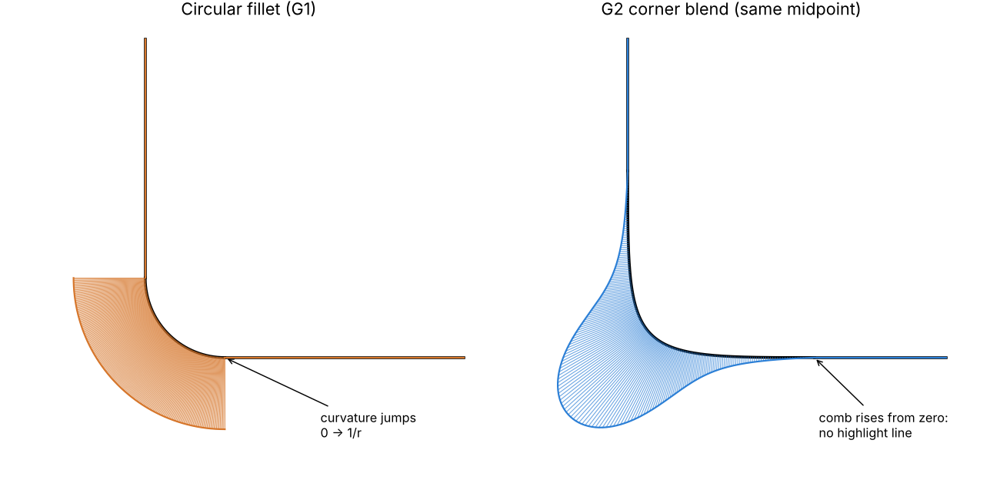

# Curvature continuity: comb, G2 matching, G2 corner blend, G2 bridge, smooth dolly (28 Oct 2026)

Stacked on `feature/honest-test-coverage`. Prompted by Steven Wittens'
[Curvature Beziers](https://acko.net/blog/curvature-beziers/): tangent alignment (G1) is not
smoothness. A join can share a tangent and still show a kink in reflections and highlights,
because curvature jumps there. DVE's NURBS tools matched positions (C0) and tangents (C1) only,
and nothing showed curvature.

## Measuring curvature (`dve/nurbs_curvature.hpp`)

- **Second derivatives.** `evaluate_nurbs_second` gives position plus first and second
  derivatives (u, v, uu, uv, vv) of any NURBS source. It uses rational quotient rules over
  basis-function derivatives (The NURBS Book A2.3), with left-hand limits at interior knots
  on request.
- **Curve curvature.** `nurbs_curve_curvature` gives the unit tangent, curvature (1/radius)
  and the curvature vector.
- **Comb samples.** `nurbs_curvature_comb` gives samples per knot span. Each interior knot is
  sampled from both sides, so a jump shows as two teeth at one place.
- **Continuity reports.** These give G0/G1/G2 with gap, tangent angle and curvature jump:
  - `nurbs_curve_internal_continuity`: a curve's own interior knots.
  - `nurbs_curve_join_continuity`: two curves. It finds the touching ends and works for either
    order and direction.
  - `nurbs_surface_join_continuity`: two surfaces. It finds the shared boundary in any
    orientation. G1 compares normals. G2 compares normal curvature across the boundary,
    perpendicular to it. Along the boundary, normal curvature already agrees once G1 holds.
- **Tolerances.** Position is relative to the geometry's size. The angle tolerance is 1e-4 rad.
  Curvature is relative to the larger curvature. All measurements are sampled floating point,
  not certified.

**Editor:**
- **NURBS > Show Curvature Comb.** Draws combs on the selected curves, in world space. Teeth
  point away from the centre of curvature, and the longest is a quarter of the curve's
  extent. A step in the outline is a curvature jump.
- **NURBS > Report Continuity (G0 / G1 / G2).** Works on one curve (its knots), two curves, or
  two surfaces. Sources are mapped to world space first (`world_editor_nurbs_source`, double
  precision), so the numbers are in world units.

## G2 boundary matching and seams

- **The construction.** `attach_nurbs_u_continuity(reference, moving, order)` with order 2
  sets the moving patch's third control row, in homogeneous coordinates, so that second
  derivatives across the boundary match too. This gives C2 in the patches' parameters, so
  G2. The end-derivative formulas are in `detail::second_row_control`. A degree-one
  reference edge has zero second derivative, so the match is then straight.
- **Options.** `NurbsAttachmentOptions::c2`, appended last so positional initializers keep
  their meaning, implies `c1`.
- **Elevation.** `attach_nurbs_boundaries` raises the moving patch to at least degree 2 with
  four controls across, so its far edge stays put. It works in all 32 boundary and direction
  combinations.
- **Menus.** NURBS > Match Other Boundary to Active (G2, Curvature), and Link Selected
  Boundaries (G2 Curvature, Shared Samples).
- **Persistent seams.**
  - The existing continuity slot of the seam record now holds 0/1/2, so old seams still
    read.
  - Seam verification also checks second cross derivatives.
  - The first three rows count as driven, so they can't be dragged off the seam.
  - Rebuilds keep G2.

## G2 corner blend

The circular fillet meets each straight leg with a curvature jump from 0 to 1/r. On a shiny
surface that shows as a hard line where the highlight changes.
`blend_nurbs_corner(corner, size, value)` makes a cubic that leaves each leg with **zero**
curvature instead.

**Not the article's solver.** For straight legs the curvature equations have exactly one
solution. Zero curvature at each end puts the third control on the first leg's line and the
second control on the second leg's line. Since each inner control also sits on its own end's
tangent, both are forced onto the corner, and the blend is X, B, B, Y. Wittens' quartic is
needed when the ends have nonzero target curvature; that is the G2 bridge below.

**Two ways to size it, both from the corner leg fraction.** This is now its own field in the
construction settings, "Corner fillet / blend leg fraction", defaulting to 0.3 (it was the
shared parameter, which stays 0.5 for splits and isocurves):

| menu | meaning |
| --- | --- |
| Create G2 Corner Blend (As Round as the Fillet) | the fillet radius that fraction gives; the blend passes through the same midpoint, so it looks as round, and reaches 4/(1+sin(θ/2)) times as far along each leg (2 to 4×; 2.34× at 90°) |
| Create G2 Corner Blend by Leg Fraction | starts where that fillet starts |

**Trade-offs.**
- **Peak curvature.** It is higher than the arc's, at the middle. The status line reports it
  next to the curvature of a circular fillet through the same midpoint.
- **Leg length.** "As round" needs legs long enough: at fraction f it reaches 2 to 4 × f of
  the shorter leg, so above about 0.43 (at 90°) it refuses and says to reduce the size. The
  default of 0.3 fits at any corner angle up to about 130° between the legs' directions.

## G2 bridge between two curves (the article's solver)

NURBS > Bridge Two Curves (G2, Curvature-Matched) joins the nearest ends of two selected curves
with a cubic that continues each one's tangent direction and curvature, sign included, so
S-bends work. `bridge_nurbs_curves_g2(a, b)`:

- **The system.** With P1 = A + l0·T0 and P2 = D − l1·T1, the signed end curvatures give
  Wittens' two coupled equations
  `1.5 k0 l0² + s l1 − c0 = 0` and `1.5 k1 l1² + s l0 − c1 = 0`, where
  s = (T0×T1)·n, c0 = (T0×(D−A))·n and c1 = ((D−A)×T1)·n. It is solved in units of the chord.
- **Solving.** Substituting l1 gives a quartic in l0. Its positive roots are found by
  recursing on derivatives and bisecting each monotone piece. Parallel tangents (s = 0)
  decouple into a·l² = c. Every candidate is checked against both equations, and handles must
  be positive (a negative one would flip the tangent).
- **Several solutions.** They are different curves. The article blends them for interactive
  dragging; this is a one-shot construction, so it keeps the single solution with the
  article's best weight, (l0·l1·acos(−cos θ)/|l|²)². That favours stable, non-looping curves:
  θ is the angle between the two equations' gradients, and near-opposite gradients mean two
  solutions about to merge and vanish. The status line says how many there were.
- **Refusals.**
  - The ends, tangents and curvature vectors must lie in one plane.
  - Some configurations have no cubic at all, for example parallel straight ends offset
    sideways, or a start that curves away from where B is. These are refused with that
    explanation.
  - Touching ends are refused too.
- **World space.** The bridge is built in world space, so the new object has the identity
  pose. The status reports the G0/G1/G2 result at both ends.

## Smooth camera dolly

Catmull-Rom dollies shape each segment in its own parameter.
- **What goes wrong.** Curvature jumps at every key. When keys are unevenly spaced in time,
  speed jumps too.
- **The fix.** `CameraDollyInterpolation::Smooth` passes through the keys on a natural cubic
  spline in time, so velocity, acceleration and curvature are continuous.
- **Trade-offs.** Each key nudges the whole path a little, and the ends have zero
  acceleration.
- **Performance.** Constant-speed sampling and length solve the spline once.
- **Format and menu.** Camera sequences are now written as v4, with the interpolation on each
  dolly line. v1 to v3 still read (as Catmull-Rom). The setting is Camera > Smooth Dolly Path
  (Curvature-Continuous), and the sequencer's `set_dolly_interpolation` makes it one undo
  step.

## Checks (`dve_nurbs_curvature_tests`)

- **Curvature.** A radius-2 rational arc has curvature 0.5 everywhere, with the vector
  pointing at the centre. A line has 0. A Bézier end matches (p−1)/p·|ΔP₀×ΔP₁|/|ΔP₀|³.
  Second derivatives on a rational surface match central differences.
- **Knots.** A cubic double knot reads G1, simple knots G2, and a polyline corner G0.
- **Blend.**
  - Zero end curvature, and the midpoint is (X+Y)/8 + 3B/4.
  - "As round" has the fillet's midpoint distance and the 4/(1+sin) reach.
  - It refuses when too large, when the corner is straight, or when the size is negative.
- **Bridges** (each checked G2 at both ends with the join report):
  - arc to line, in either order and with B reversed;
  - an S-bend;
  - straight ends at an angle (the bridge leaves both ends with zero curvature);
  - collinear ends.

  Out-of-plane ends, parallel straight ends offset sideways, and touching ends are refused.
- **Joins.**
  - A leg into the fillet is G1, with a jump of exactly 1/r.
  - A leg into the blend is G2, in either order and direction.
  - A corner is G0, and a gap reads as not connected.
- **Surfaces.**
  - C2 attach matches second derivatives and keeps the far edge.
  - The report reads C1 attach as G1 and C2 attach as G2.
  - A linear moving patch is refused at the low level and elevated by the boundary attach.
  - All 32 orientations come out G2.
- **Seams.** A G2 link validates and round-trips. The third row is driven and the far edge is
  not. The world-space report says G2, and a rebuild keeps it.
- **Editor.**
  - Attach G2 from the menu, then the report says G2.
  - The unmatched originals read as not connected.
  - At the default corner fraction (0.3), "as round" fits (setback 2.812).
  - Both blend modes work through the menu with undo, and the status reports setbacks 1 and
    2.343 at fraction 0.25, set through the new field.
  - The bridge is built in world space from posed objects, reports G2 at both ends, and is
    one undo step.
  - The comb toggles, and a mixed curve-and-surface report is refused.
- **Dolly.**
  - Both modes pass through every key.
  - At an unevenly timed key, Catmull-Rom jumps in speed and acceleration and Smooth does
    not.
  - Natural ends; progress and length work.
  - v4 round-trips, v3 reads as Catmull-Rom, an unknown value is refused, and the sequencer
    supports undo.
- **Updated.** `test_camera_cinematic` now expects v4.
