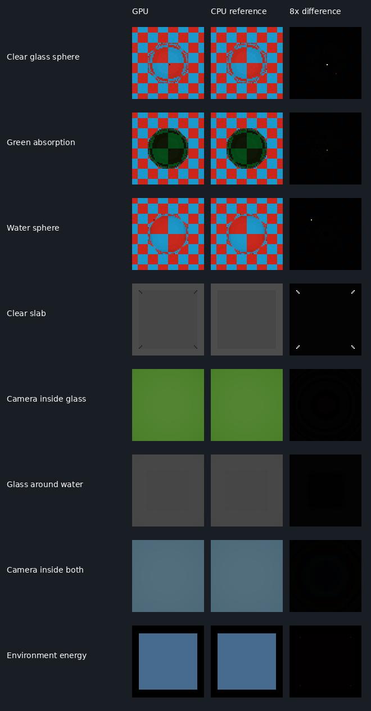

# Materials Batch 5: live GPU clear-glass transport

The live polygon renderer now follows camera rays through clear solid dielectrics. Glass
sees reflected and refracted polygon geometry, with exact dielectric Fresnel, Snell
refraction, total internal reflection, radiance-mode eta-squared weights and metric
Beer–Lambert absorption. This is a bounded software ray tracer in the fragment shader;
no hardware ray-tracing extension is required.

Clear glass, colored glass and water presets become **Approximate** on the GPU capability
filter. Rough/frosted glass stays **Unavailable**. Native scene viewport presentation and
GPU voxel transport remain outside this path. The CPU material preview remains available.

## Live integration

Supply `LiveEnvironmentShaderBytecode::clearGlassFragment` with the compiled
`live_clear_glass_ps` bytecode when creating the existing live renderer. The field is
optional for opaque scenes. `record_live_environment_frame` detects transmissive submeshes,
validates the optical scene before publishing ordinary descriptors, builds/uploads its
hierarchy and switches those draws to the optical pipeline. Missing optical bytecode returns
an actionable error instead of drawing transmission as opaque paint.

The raster pass supplies primary visibility and the direction from the perspective camera.
The glass fragment then traces the complete optical path from that camera. Glass retains
full coverage and writes its front surface depth; this is not alpha blending with the
background. Both reflected and refracted branches can intersect geometry behind the camera
or outside the visible screen. Ray misses sample the existing specular environment's level
zero. Environment rotation, intensity and exposure retain the live renderer's conventions.

Supported scenes contain:

- Closed, consistently outward-wound polygon dielectrics, with transmission=1, roughness=0,
  metallic=0, clearCoat=0, no interface emission, and full material/vertex coverage.
- Opaque standard-PBR receivers with constant material values, interpolated vertex color and
  smooth normals. Their existing IBL response and optional emission terminate the optical
  path; this does not add recursive opaque reflection/diffuse GI.
- Rigid instances with scale baked into geometry and positions/translations in metres.
  Use separate draws for separate poses, with one instance per draw.
- Disjoint or properly nested media. Perspective projection and camera position must agree.

Unsupported textures, procedural recipes, layers, height mapping, masks, alpha translucency,
rough/partial transmission, non-PBR receiver models, receiver clear coat, non-rigid poses,
DASHR combinations and orthographic cameras return errors. Open, reversed or non-manifold
volume topology is refused. Closure welding uses positions relative to each volume's bounds,
including duplicated UV/normal seams. Self-intersecting/interpenetrating or touching volumes
are outside the supported medium contract.

Transmissive meshes are omitted from the ordinary opaque shadow caster pass. Colored
transmission shadows and focused caustics require separate light transport; this change does
not substitute opaque depth for clear glass. The current live shading pass evaluates IBL.

## Scene data, media and lifetime

A CPU-built, median-split bounding-volume hierarchy stores world-space triangles. Preorder
nodes carry escape indices for stackless GPU traversal; leaves contain at most four triangles.
Triangle records carry positions, interpolated normals/colors and a material index. Material
identity includes the instance, so equal material slots on separate objects remain distinct
media. The existing 116-byte material record and 176-byte mapping record are unchanged.

| Optical descriptor, set 4 | Binding | Record stride |
| --- | --- | --- |
| Hierarchy nodes | 0 | 48 bytes |
| Triangles | 1 | 112 bytes |
| Material records | 2 | 116 bytes |
| Settings / initial media | 3 | 64 bytes |

C++ size/offset assertions and compiled Vulkan descriptor reflection protect these contracts.
The additional pipeline requires five descriptor sets; physical-device acceptance is pending.

The scene owner caches geometry/materials by asset content hash and rigid pose. Identical
frames reuse the upload; camera changes update containment/settings without rebuilding the
hierarchy. Recompute asset hashes after edits. Upload publication is transactional, and old
resources are destroyed after GPU idle. The existing live renderer serializes per-frame
uniform reuse; this remains a correctness-first path, without an asynchronous performance
claim. The owner releases buffers, descriptors and layout during renderer teardown.

Initial camera containment uses an oblique oriented surface query for each closed connected
component of each dielectric. Containing components are ordered outside-to-inside by their
own volume (never a material's aggregate volume); a camera inside two nested components of
the same material is refused. While the camera is inside any medium, every primary draw,
including opaque receivers, uses the optical transport pipeline so camera-to-receiver
absorption is applied; the shader pushes at entry and restores
the enclosing IOR at exit. A mismatched exit is terminated rather than assigned a guessed
medium. Absorption covers the segment from a camera already inside a medium to its first
surface as well as subsequent internal segments. Cameras exactly on interfaces require an
explicit positional offset.

The bounded defaults are 32 interactions, 256 processed paths and 24 pending paths per
fragment, eight dielectric media in the scene, 4,096 material records and 1,048,576 triangles.
Pending paths are selected by greatest remaining throughput; a full queue retains the
higher-throughput candidate. Paths below 1e-5 throughput are discarded. Budgets can lose
residual energy and do not constitute an unbiased/converged path-tracing estimate. Segment
range is 1,000 m; base origin epsilon is 1e-5 m with a world-coordinate precision adjustment.
Very thin shells and extreme world coordinates need separate precision acceptance.

The CPU optical Fresnel helper also now returns zero for equal IOR at exact grazing incidence:
there is no interface in that case. The GPU/CPU conformance probes include this boundary.

## Acceptance

Release validation uses Mesa lavapipe with `DVE_REQUIRE_VULKAN=1`, so GPU tests execute instead
of taking an unavailable-device skip.

- Nine live scenes: clear sphere, green absorption, water sphere, slab, camera inside glass,
  glass around water, camera inside both media, camera inside absorbing glass with an opaque
  receiver before the exit surface, and constant-environment energy/intensity/
  exposure. The final case expects RGB (0.28, 0.42, 0.56) from environment (0.2, 0.3, 0.4),
  intensity 0.7 and exposure +1 EV.
- 1,455 sampled RGB channel comparisons against an independent reference using the existing
  CPU `OpticalScene`, Fresnel/refraction and absorption functions. That reference uses its
  existing polygon BVH, up to 24 interactions and 2,048 paths. Maximum observed sampled error
  is 0.00224715; tolerance is 0.025 including RGBA8 quantization and bounded path differences.
- 84 compute probes compare Fresnel, Snell direction, total internal reflection and RGB
  absorption across four incident IORs, three transmitted IORs and seven incidence cosines,
  including exact grazing and normal incidence. Fresnel tolerance is 2e-5; direction tolerance
  2e-4; absorption tolerance 1e-5.
- Closure, camera containment, resource lifetime, unchanged-frame caching, camera-only updates,
  material edits and unsupported-scene refusal tests. Missing shader refusal happens before
  descriptor publication. Live frame statistics expose optical draws, scene triangles and
  rebuild counts.
- Twelve selected suites pass, including the existing live renderer, preset/native workflow,
  CPU transport/optics, sampled textures,
  surface recipes, shared residency and material mapping regressions are checked. Both
  manifests include the new code/shaders/tests/documentation and gallery. The standalone
  DASHR live-surface/live-renderer runner also passes.

These numeric bounds describe the sampled probes, not every image pixel. The full-frame
gallery retains differences at non-unique sharp-corner paths: twelve slab pixels at this
64x64 resolution differ by about 0.149 in linear RGB because CPU and GPU choose different
simultaneous corner interfaces. Nested fixtures use unequal side lengths to avoid those
exact ties. The grid probes are offset between X/Y. Beveled/smooth solids avoid a sharp
corner's undefined optical normal; this batch does not claim watertight corner-ray parity.



The gallery is linear RGBA8 diagnostic output, without display gamma. Difference images
show 8x absolute RGB error. Test readbacks are 64x64; each cell is enlarged with nearest-neighbor
sampling. Checker receivers are standard-PBR materials with emission and environment intensity
zero, isolating optical transport from different lighting approximations.

## Reproduce

Configure a Release Vulkan build with a SPIR-V-capable `DVE_DXC_EXECUTABLE` and build
`dve_gpu_clear_glass_tests`. The test runs CPU/Null-device checks before its Vulkan section.

```sh
DVE_REQUIRE_VULKAN=1 build/dve_gpu_clear_glass_tests build/surface-shaders build/batch5-glass-gallery
sh scripts/run_dashr_null_rhi_tests.sh
python3 tools/validate_shader_contracts.py
python3 tools/validate_shader_contracts.py --self-test
python3 tools/verify_compiled_shader_reflection.py --self-test
python3 scripts/compile_shaders.py --backend dxil --out build/batch5-canonical
python3 scripts/compile_shaders.py --backend spirv --out build/batch5-canonical
sh scripts/update_source_manifest.sh --check
```

Run SPIRV-Cross `--reflect` and the compiled interface checker for the nine manifest entries
with explicit Vulkan bindings. The inventory now has 62 canonical shaders (124 DXIL/SPIR-V
artifacts), including the optical material pass and dielectric probe shader.

This acceptance covers software Vulkan and the canonical live polygon API. Hardware GPU,
D3D12/Metal execution, native viewport presentation, voxel interfaces, textured secondary
shading, rough transmission, caustics and denoising remain subsequent work. No persistence
version or external asset dependency changes.
