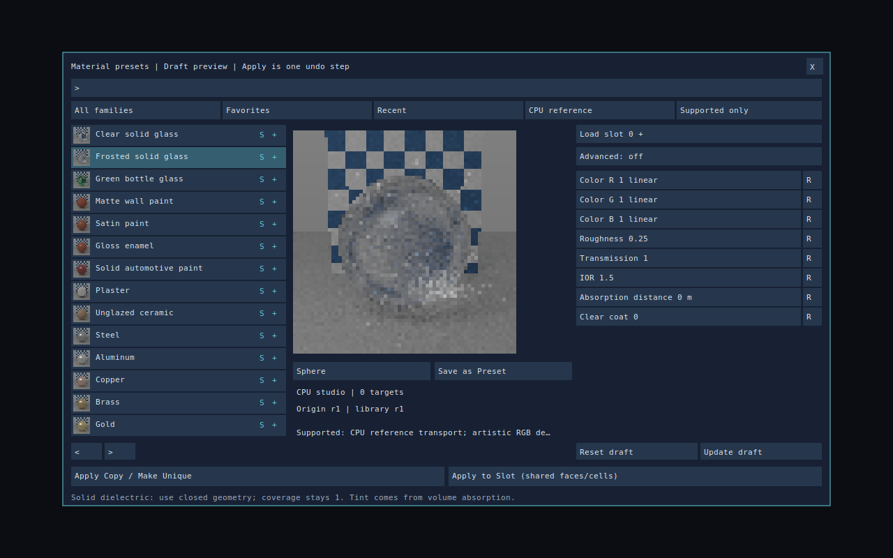
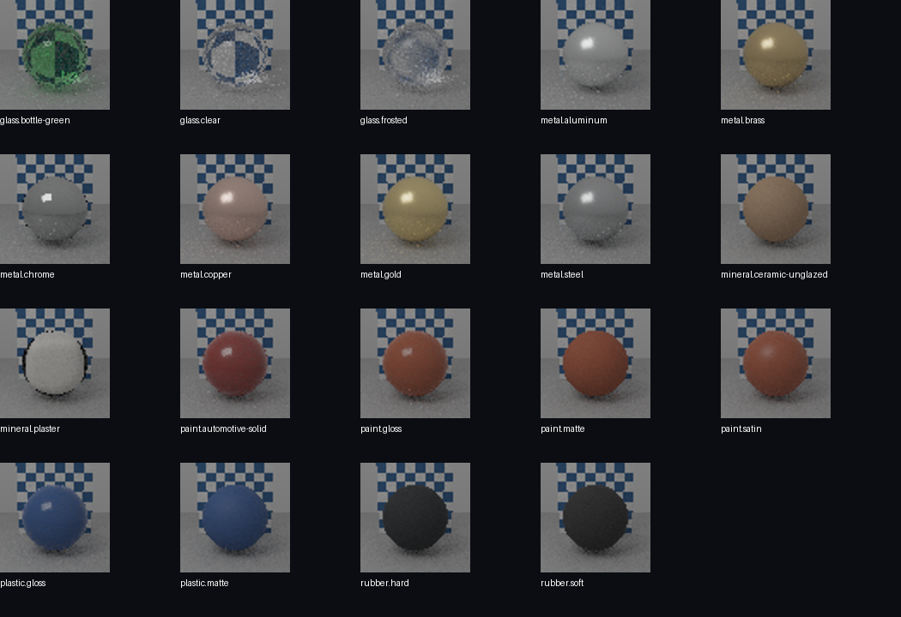

# Material presets: Batch 1

Batch 1 adds an actual native material browser and CPU studio preview to **Materials > Material Library**. The old action only opened project settings. Presets are editable visual starting points; applying one preserves each target material's density, structural strength, fracture resistance, flammability, conductivity and structural flag.





## Artist workflow

1. Select objects, polygon faces or occupied voxel cells, then open **Materials > Material Library**. Polygon, subdivision and NURBS surfaces use their own saved material tables; voxel materials use object-owned palettes.
2. Search by name or synonym, cycle families, or filter favorites/recent choices. Each row has a CPU-rendered thumbnail and **S** (supported), **A** (approximate) or **U** (unavailable) for the selected backend. Click the star area to favorite a preset; `Ctrl+F` toggles the current favorite. Favorites and the last twelve applied presets persist beside user settings.
3. Inspect the CPU preview with a sphere, thin solid patch, rounded box or thickness wedge. Lighting, camera, exposure, geometry scale and random seeds are fixed. The sample is 10 cm across; the patch is a closed thin solid, **not** a thin-wall shader. A checker chart behind the sample makes refraction/frosting visible.
4. Click a property to type a finite number; press Enter to accept the draft value. Units, meaning and accepted range appear in the footer. **R** resets one property. An asterisk identifies a local override. **Advanced** exposes the complete scalar set; wheel over the inspector to scroll. In opaque PBR, Reflection is the existing specular/F0 control; solid glass uses IOR-derived Fresnel reflection.
5. **Apply Copy / Make Unique** creates independent material slots for the selected surfaces/cells, leaving other assignments unchanged. When targets have different physical profiles, separate new slots preserve those profiles. Selecting an existing preset never mutates that library preset. One Apply is one scene undo step, including material definitions, texture bindings, palettes, cell/face assignments and active paint selection.
6. To edit an existing assignment, choose its slot with `[` / `]` (or the + area), click **Load slot**, edit the draft, then **Apply to Slot**. This affects all faces/cells using that slot on the selected objects. Object-owned slots are local; numeric slot equality across unrelated objects is not a global material link. NURBS source surfaces retain their single material domain at slot 0 across re-tessellation.
7. **Reset draft** uses the exact originating revision when available. **Update draft** explicitly adopts the installed preset revision while retaining tracked local overrides; inspect the draft and apply it to commit an undoable scene change. The origin and available revision are displayed. Reopening a scene never updates its preset values automatically. A missing preset leaves the saved resolved material intact.
8. **Save as Preset** writes a versioned `.dvepreset` in the project's `Materials/Presets` directory (or beside user settings when no project is open). Custom presets load into the User family when the browser opens. The preset embeds its normal-detail dependency; it needs no external texture download.

Keyboard: Up/Down select a preset, Page Up/Down page the list, Tab enters the first visible property, Enter applies a copy when no field is being edited, Shift+Enter applies to the chosen slot, Ctrl+Z/Y use scene history, Escape cancels a field or closes the panel. Closing cancels background image work.

Locked, hidden, isolated-out, unsupported and incompatible targets are refused before mutation. Text3D and Gabor-volume material authoring remain in their existing dedicated workflows. Selection-wide voxel application is capped at 500,000 cells per object; apply larger objects in regions. Palette/slot exhaustion reports a refusal rather than wrapping IDs. Preset assignment does not edit geometry or create corrugation, flakes, fibers, volume scattering or a thin-sheet model.

## Starter library

| Family | Presets |
|---|---|
| Glass | Clear solid, frosted solid, green bottle |
| Paint | Matte wall, satin, gloss enamel, solid automotive |
| Mineral | Plaster with original embedded fine normal detail; unglazed ceramic |
| Metals | Steel, aluminum, copper, brass, gold, chrome |
| Plastic/rubber | Gloss plastic, matte plastic, hard rubber, soft rubber |

There are **19** starter presets. Colors and roughness are artistic defaults, not measured fits. Clean metals use metallic=1 and linear RGB reflectance colors. Solid car paint uses pigment and a clear coat; metallic flakes and pearl effects remain later work. Plaster's normal map uses a 2 cm object-space repeat and small tilt; bump detail does not change silhouettes. Its original generated texels and provenance are embedded in the preset asset. Shared scalar normal detail is evaluated on CPU polygon raster and continuation hits as well as existing voxel shading.

Clear solid glass has full coverage, transmission=1, IOR=1.5 and roughness=0. Frosted glass uses roughness=0.25. Bottle tint comes from distance-based volume absorption, with a 10 cm attenuation reference. Solid transmission requires closed geometry; existing alpha-only materials are not automatically converted.

## Schema and persistence

`MaterialPresetAsset` stores schema version, stable ID, revision, name/family/tags, description, shader requirements, mapping units, dependencies, provenance and thumbnail revision. The `.dvepreset` writer uses a deterministic metadata prefix followed by the common material serialization, containing only air plus the default definition. Readers reject unsupported schemas/features, duplicate catalog IDs, unresolved dependencies, unsupported preset models and invalid finite ranges. Batch 1's standalone preset models are Standard PBR and Clear Coat, including solid dielectric optics.

Resolved material values remain authoritative. `MaterialPresetOrigin` adds only ID, revision and property-override bits. Editor material libraries use version 6 when provenance is present, DVOX uses 1.6, and DMESH uses 1.5 for provenance or embedded scalar normal maps. Files without the new fields keep their prior format selection and hashes. The readers retain older format support. Scenes, autosave and prefabs that use DVOX/DMESH carry these material values and embedded dependencies. Broader cooked/runtime import-export and game-save provenance acceptance belongs to MAT-037; this authoring work does not claim it.

Applying a preset resets old polygon texture bindings along with the visual definition. Undo restores the complete old mesh material/binding table and its retained image/texture resources. Physical properties stay independent. User preset files are self-contained; an applied scene also has its own values and does not depend on the custom file remaining installed.

## Preview and backend boundaries

The preview uses `SceneLighting::camera_transport`, the same CPU transport as glass and rough materials, with 32 paths/pixel and 8 bounces. It is a bounded 64×64 look-development thumbnail, not a converged final render. One selected-preview worker and one visible-thumbnail worker have bounded caches. Jobs own immutable snapshots, cancel between rows, and commit only when their generation still matches. New edits cannot be overwritten by an older result. Keys include the full resolved material, shape and fixed renderer/studio revision. Browser thumbnails also carry preset and thumbnail revisions.

| Backend | Status in this batch |
|---|---|
| CPU reference / material studio | Supported for these preset models; numerical smoke checks and low-sample review gallery |
| CPU player | Approximate/unverified integration; no blanket player scene-parity claim |
| Native scene viewport | Approximate color-marker display; use CPU studio to inspect shading |
| GPU | Solid/rough camera glass unavailable; other starters marked approximate pending backend acceptance |

Unavailable backend choices block Apply with a reason. Approximate choices retain the requested material values and advertise their limitation. Changing the backend filter never converts glass into opaque paint.

## Reproduce

```sh
cmake --build build --target dve_editor_material_presets_tests dve_material_preset_gallery
ctest --test-dir build -R '^dve_editor_material_presets_tests$' --output-on-failure
build/dve_material_preset_gallery build/material-gallery
```

The gallery command creates a browser-readable `index.html`, BMP/PPM images, standalone preset assets and an SVG drawn through the actual native panel's canvas interface. It runs without a window or GPU. Native windowed and GPU visual acceptance still require those environments.

The dedicated suite covers catalog validation, deterministic preset assets, library/DVOX/DMESH/scene round trips, embedded detail, missing origins, explicit upgrades and overrides, mixed-target physical preservation, copy/slot edits, one-step history, rejected mutations, locked-target atomicity, face and voxel regions, user presets/favorites, layout bounds, latest-preview replacement, caching and cancellation. Existing editor, optics, material transport, normal-map and scene-export regressions are also relevant.

### Recorded local validation

GCC 13.3 Release: 13/13 selected CTest suites passed (preset workflow, editor, honest commands/followups, optics, transport, voxel normal maps, scene export, native polygon editing, subdivision, NURBS, polygon geometry and polygon rendering). The gallery command rendered all 19 starters and populated the native browser thumbnail screenshot.

A focused ASan/UBSan executable also passed. It instruments the dedicated test plus `editor_material_presets.cpp`, `editor_material_preview.cpp` and `editor_native_materials.cpp`, linking the remaining engine archives from Release; leak detection is disabled. This is not a full sanitized engine or a GPU/windowed run.
