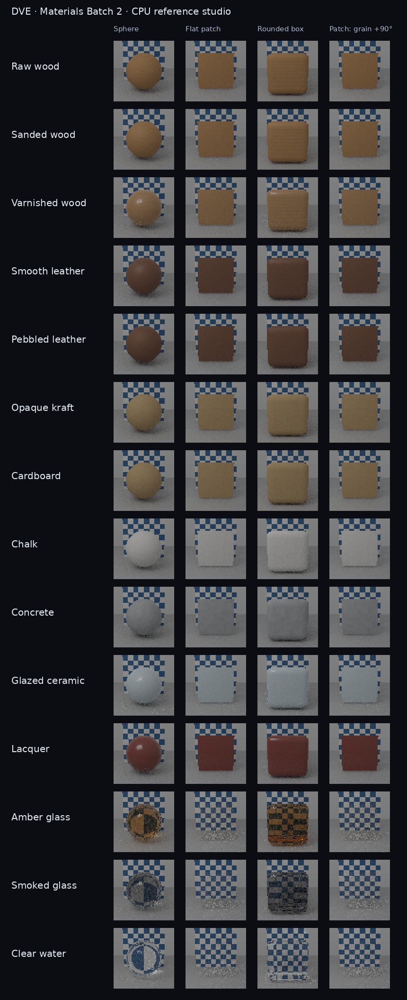

# Materials Batch 2: surfaces and textured transport

This batch adds fourteen presets (33 total). The eleven opaque presets carry original,
self-contained procedural recipes; the three dielectrics use the existing closed-volume
transport. No downloaded textures, new licensing obligations or project-relative paths.

| Family | New presets |
| --- | --- |
| Wood | Raw, sanded, varnished |
| Leather | Smooth, pebbled |
| Paper and board | Opaque kraft paper, cardboard |
| Mineral | Chalk, concrete, glazed ceramic |
| Paint | Lacquer |
| Glass | Amber bottle, smoked |
| Liquid | Clear water |

Varnish, glaze and lacquer use the existing separate clear-coat lobe. Fine base detail does
not change coat roughness. Paper and cardboard are opaque; cardboard cut edges need geometry.
Water needs a closed volume. These are artistic defaults, not measured material fits.

## Authoring and mapping

The material inspector exposes pattern, mapping space, period in metres, XYZ orientation
in radians, grain stretch, color and perceptual-roughness variation, bump height in metres,
seed and the metric size of one UV tile. Object mapping follows a rigid object's translation
and rotation; world mapping stays anchored. UV0/UV1 require polygon UVs and are refused on
voxel targets before a command is added. Bump perturbs shading normals, not silhouettes.
The bump bound is one quarter of the period; invalid edits leave the draft unchanged.

Wood uses a common 3D field for side grain and growth rings; paper uses elongated noise;
leather uses smooth pore variation. Mineral and paint use several noise octaves with
preset-specific scale and strength. Analytic gradients drive bump. Frequency bands and
normal derivatives fade with the physical pixel footprint. This is approximate procedural
filtering rather than an exact convolution, especially for warped wood fields.
Very large or nonfinite coordinates fall back to the neutral mean.

## Renderer scope

CPU polygon rasterization and CPU voxel primary shading evaluate these recipes. The CPU
path tracer also resolves recipes at polygon and voxel secondary hits. Polygon continuations
sample base color, metallic/roughness, normal, emissive and opacity maps, detail maps and
per-pixel material layers. Triangle-light samples evaluate the same textured emission.
Instance tint affects base color and does not multiply emission.

Ray filtering uses an approximate segment cone (0.006 times hit distance), not full ray
differentials. The shared mip cache retains at most 64 MiB; live renderers retain their
referenced chains and oversized assets can exceed this during rendering. Normal maps use
raw normal mip chains; color/emission use sRGB chains when declared. Triplanar normal LOD
uses position derivatives, independent of unused UV coordinates.

View-dependent parallax, displaced secondary geometry and coarse SPWI indirect-probe parity
are outside this batch. GPU recipe support remains explicitly unavailable in the browser;
native/player presentation remains marked approximate. Wax, cloth sheen, anisotropy,
metallic flakes, pearl and thin-sheet transmission remain deferred.

## Persistence and compatibility

| Container | Version when a recipe is present |
| --- | --- |
| `.dvepreset` / material library | 7 |
| DVOX | 1.7 |
| DMESH | 1.6 |
| Game save | Optional `dve.material_surface_detail` section |

Legacy materials keep their previous encoding versions. The recipe stores enums, seed and
nine canonical floats; loaders validate bounds and enum values. Game-save entries reject
duplicates and invalid object/material references. Polygon and game-world hashes include
recipes; game-world hashes now also include embedded normal-map content and parameters.
Scene saves and packaged material definitions use these same containers, with no extra
texture dependencies. Preset provenance and overrides survive copies and round trips.

## Reproduction and review

Build `dve_material_surfaces_tests`, `dve_editor_material_presets_tests`,
`dve_material_transport_tests`, `dve_game_save_tests` and `dve_material_preset_gallery`.
Run the tests, then `dve_material_preset_gallery /tmp/dve-surfaces --surfaces`.
The surface gallery renders the fourteen additions on a sphere, patch, rounded box and
90-degree rotated patch: fixed CPU studio, 64-square pixels, 32 paths, eight bounces.
Run `python scripts/material_surface_contact_sheet.py /tmp/dve-surfaces
 docs/images/material-surfaces-batch2/surface-gallery.png` to assemble the contact sheet
(requires Pillow and DejaVu Sans). The checked-in contact sheet is a visual smoke test,
not a claim of backend acceptance.

Regression cases cover deterministic seeds, analytic gradients, minification, rigid mapping,
UV refusal, all recipe fields through preset/DVOX/DMESH/scene/save round trips, linear data
maps, UV-independent triplanar normal filtering, and textured emission through reflection
and refraction. Existing project-switch cache isolation is retained.

Earlier Codex reviews informed explicit checks here:

- PR #191: raw normal-map decoding and complete material persistence/hashes.
- PR #192: position-derived triplanar normal LOD.
- PR #196: emission tint consistency between beauty and triangle-light sampling.
- PR #200: project-switch catalog and preview-cache isolation (retained from main).

