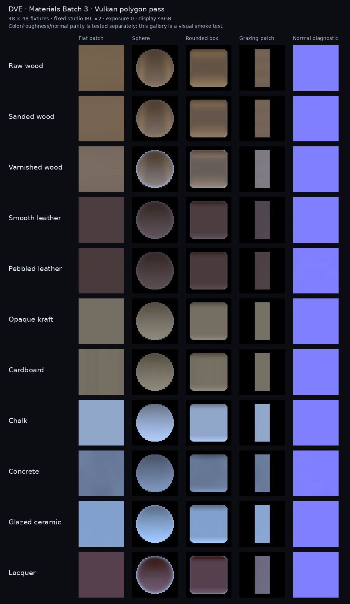

# Materials Batch 3: live GPU polygon surfaces

The live GPU polygon pass now evaluates Batch 2's eleven opaque surface presets:
wood, leather, paper/board, mineral and lacquer. The original HLSL implementation mirrors
DVE's CPU recipe equations, including seeded lattice noise, analytic gradients, metric
period/bump height, orientation, grain stretch, and color/roughness variation.

## Mapping and rendering

Object, world, UV0 and UV1 recipes use the same authoring fields as the CPU reference.
Mesh positions and instance translations are metres. Instances carrying recipes must have
rigid transforms; unapplied scale, shear and reflection are rejected with an actionable
error. Bake scale into geometry before submitting these draws. Object-space gradients
rotate into world space; world recipes remain anchored; UV recipes use their selected
channel and metric tile size. Bump changes shading normals, without displacement.

The physical pixel footprint comes from position derivatives, or the selected UV channel
for UV recipes. Frequency bands fade with footprint, and tangent-plane bump slopes remain
bounded. This retains the CPU's approximate filtering rather than an exact convolution.
Normal textures are decoded as raw data; color/emission follow their declared color space.
Triplanar texture and normal derivatives come from the selected position space. Shared GPU
image residency currently uploads one mip level: full texture mip-chain/minification parity
is still pending, even though analytic recipe minification is covered here.

The live pass now uses the camera position for view-dependent IBL, applies environment
intensity/exposure, and evaluates the separate clear-coat lobe. A fixed shadow-atlas texel
previously multiplied the entire environment integral; that unrelated lookup is removed.
Directional sunlight integration is outside this IBL pass. The existing shadow-caster pass
remains available independently.

## GPU contracts and edits

| Contract | Layout |
| --- | --- |
| Existing material record | Unchanged, 116 bytes |
| Surface recipe record | Separate scalar-only 64-byte buffer, set 3 / binding 13 |
| Polygon vertex | 72 bytes; UV1 appended at offset 64, existing offsets preserved |
| Frame constants | View-projection at 0, environment parameters at 64, camera float4 at 80 |

Renderer creation requires at least 96 bytes of frame-buffer capacity. Callers supply the
view-projection and environment data; the renderer writes the camera from
`LiveEnvironmentFrameDesc::cameraWorldPosition`. Environment parameters are rotation,
intensity, exposure EV and maximum specular mip, in that order.

Surface records follow the existing content-hash descriptor cache. Recompute an edited
asset's content hash and invalidate its previous cached resources after GPU use completes.
New recipe records are separately aligned to device storage-buffer requirements. Fallback,
rollback, invalidation and teardown paths own the additional buffer. Tests verify an edited
seed creates a fresh record and that all resources are released.

Explicit SPIR-V descriptor attributes match the live RHI's descriptor sets and combined
image/sampler slots. The shader manifest retains HLSL registers and separately records the
compiled Vulkan interfaces for all six live shaders and the conformance compute shader.
The reflection checker verifies exact resource names, kinds, sets and bindings. A struct
conditional in the brick-palette resolver is expressed with equivalent branches so DXC can
compile the complete inventory.

## Acceptance evidence

Release builds and the following eleven suites passed, with `DVE_REQUIRE_VULKAN=1` on Mesa
lavapipe. GPU tests therefore executed rather than returning an unavailable-device skip.

- GPU surface conformance, Vulkan live renderer, GPU material buffer.
- Material surfaces, preset catalog, mapping, game-save round trips.
- Subsurface diffusion, live renderer contracts, main material table, shared residency.

The compute test checks 192 CPU/GPU value/gradient samples over all patterns, four seeds,
positive/negative positions, rotation, stretch and four footprints. Maximum observed value
error was 0.00110227; value tolerance is 0.004. Gradient tolerance is 0.8 plus 1.5% of the
reference magnitude to accommodate floating-point phase differences.

The live test compares 3,960 pixel samples (four channels each) over eleven presets,
object/world/UV0/UV1 mapping and minification, in color/roughness and normal/roughness modes.
Channel tolerance is 0.009, including 8-bit readback quantization. Separate sampled-image
checks verify sRGB color, linear roughness and raw normal decoding. Non-rigid recipe draws
are refused. Persistence tests retain Batch 2's existing containers; no format version changes
or new packaged texture dependencies are introduced.

All 60 canonical shaders compiled with DXC to both DXIL and SPIR-V (120 artifacts). All seven
live/reference compiled Vulkan descriptor interfaces matched the manifest. Source inventory,
CPU/HLSL ABI and reflection-checker self-tests passed. `SOURCE_MANIFEST.sha256` is regenerated
with this batch.

Batch 2's latest fixes are included in the base: DVOX refuses UV-space recipes, and procedural
bump preserves subsurface-diffused sunlight. Batch 3 extends coverage to UV1 cooker rejection
and a neutral recipe on a diffused shadow edge. The base also retains its MSVC min/max fixes
and DASHR test-runner link fix. The subsequent X11-safe `NoPattern` enum rename is retained. The standalone DASHR runner also links the new GPU recipe
packer in this batch. Prior merged reviews informed raw normal decoding (#191),
position-derived triplanar sampling (#192), and keeping instance tint out of emission (#196).

## Reproduction

Configure with Vulkan, editor libraries, tests, and a DXC executable:
`-DDVE_DXC_EXECUTABLE=/path/to/dxc`. Build `dve_gpu_material_surfaces_tests` and the other
suites above. The target compiles the canonical live shaders and diagnostic variants.
Run `DVE_REQUIRE_VULKAN=1 build/dve_gpu_material_surfaces_tests build/surface-shaders /tmp/dve-gpu-surfaces`.
Then run `python scripts/material_surface_gpu_contact_sheet.py /tmp/dve-gpu-surfaces
 docs/images/material-surfaces-batch3/gpu-surface-gallery.png` (Pillow and DejaVu Sans;
`--font` accepts another DejaVu Sans path).

The gallery uses 48-square-pixel fixtures, a 24 mm flat field, approximately 20 mm curved
objects, fixed studio IBL intensity 2 and exposure 0. Beauty readbacks are linear and are
encoded to sRGB for display; normal diagnostics retain their data values. Small leather/paper
features can fade at this footprint. Images are a visual smoke test; the numeric diagnostics
provide recipe parity evidence, not full CPU/GPU lighting-transport equivalence.

For shader checks, run `python tools/validate_shader_contracts.py` and both validator
`--self-test` modes. Compile canonical shaders with `scripts/compile_shaders.py`; obtain
SPIRV-Cross JSON using `spirv-cross shader.spv --reflect`, then pass it to
`tools/verify_compiled_shader_reflection.py --manifest shaders/shader_manifest.json
 --shader <name> --reflection <file.json>` for each live/reference shader.

## Support boundary and reference

GPU surface support remains **Approximate** in the preset capability labels: this batch
validates the live polygon pass. Native editor viewport presentation and GPU voxel recipe
shading remain unverified/unintegrated. GPU transmission, secondary transport, displacement,
SPWI parity, full texture mip chains and broader mapping/coat parity remain separate work.
CPU surface rendering and persistence remain available from Batch 2.

[BumpMesh](https://bumpmesh.com/) helped as an authoring reference for physical scale,
projection and relief workflows. Its linked [stlTexturizer](https://github.com/CNCKitchen/stlTexturizer)
implementation is AGPL-licensed. No source code or assets were copied. DVE's GPU evaluator
is an original implementation of its own CPU recipe. Geometry baking and masks are deferred.

