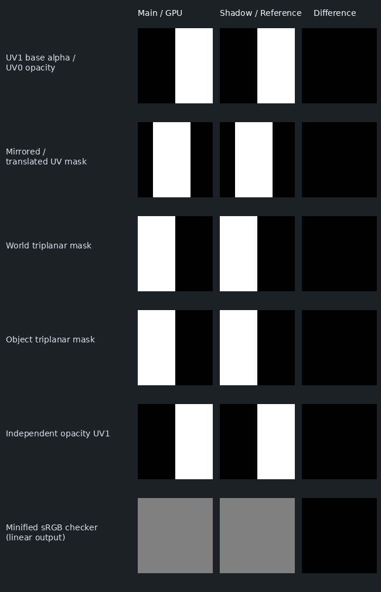

# Materials Batch 4: live GPU texture filtering and mapping

The live polygon material and masked shadow passes now share mapping and sampling code.
Shared image residency uploads every mip down to 1x1. This supersedes Batch 3's documented
single-level texture limitation while retaining the **Approximate** preset support label.

## Filtering and residency

| Binding semantic | Resident format | Mip reduction |
| --- | --- | --- |
| Declared sRGB base color / emission | RGBA8Srgb | Decode RGB, area average, re-encode; alpha stays linear |
| Linear color, metallic/roughness, opacity and other data | RGBA8Unorm | Area average raw channels |
| Normal / detail normal | RGBA8Unorm | Average decoded vectors and normalize each reduced level |

The shared CPU/GPU mip generator uses fractional area weights for odd dimensions. Top-level
source bytes are retained. Zero-length reduced normals fall back to +Z. An existing alpha
bug is fixed: `Float4{}` initializes alpha to one, so accumulation now explicitly starts at
`{0,0,0,0}`. Alpha is averaged; alpha-test coverage preservation is not implemented.

sRGB residency makes hardware decode happen **before** bilinear/trilinear filtering; the
live shader no longer decodes a filtered color sample afterward. Color and data bindings
of the same source image get distinct cached resources, keyed by asset content hash,
image index and interpretation. Normal mip chains are also distinct. Main and shadow tables
share compatible color/data resources through the existing reference-counted pool.

Authored DVE wrap and min/mag filter choices are preserved. The global sampler policy can
select nearest/linear mip filtering and device-clamped anisotropy. Trilinear filtering is
no longer downgraded for single-level uploads. DVE's existing two-choice imported filter
representation is unchanged; this does not add every glTF minification enum.

Residency diagnostics expose uploaded mip counts, cumulative image bytes and current resident
image payload bytes. These are logical RGBA payload sizes, excluding backend allocation
padding, buffers and fallback textures. Image edits still require recomputing the asset hash;
release/invalidate old descriptors only after their GPU work finishes. Tests retain the old
asset while uploading an edited one, then verify eviction and balanced resource lifetimes.

## Mapping and shader contracts

Base color, metallic/roughness, normal, emission and opacity independently select UV0/UV1.
The existing global UV1 mode overrides those selections. Base transforms apply consistently
to these maps. World/object triplanar projections use derivatives of the selected position
space, independently of unused mesh UV derivatives. The shadow pass receives both UV sets,
positions and geometric normals, and evaluates the same base-alpha/opacity mapping.

Neutral triplanar normal maps and normalScale=0 preserve the geometric normal. Each projected
normal perturbation is reoriented around that normal before weighted blending. Derivative
frames honor the transformed UVs; degenerate frames retain the geometric normal.

The material record stays **116 bytes**, mapping record **176 bytes**, and object constants
**96 bytes**. One formerly reserved mapping uint carries additional per-map UV selectors.
The shadow material descriptor adds a mapping storage buffer at **set 3 / binding 2**; it is
owned and cleaned up with the descriptor. Deploy matching shaders and renderer binaries.
The legacy single-UV object flag remains source-compatible, but this caster uses the richer
mapping buffer. The shader contract validator checks this shared mapping path.

## Acceptance evidence

On a Release build refreshed onto main at `d6b7939`:

- Nine selected CTest suites passed: shared residency, material mapping, settings/render,
  live renderer, main descriptors, Vulkan live renderer, material surfaces, CPU surface
  detail and polygon rendering.
- Real Vulkan execution on Mesa lavapipe with `DVE_REQUIRE_VULKAN=1`: 28 new texture/mapping
  render cases and 18,000 main/shadow visibility comparisons. Cases cover independent UVs
  for all five sampled semantics, global UV1, repeat/clamp/mirror, nearest/bilinear,
  decode-before-filter, fractional trilinear LOD, full color/data/normal mip chains,
  linear alpha, position-derived triplanar LOD, neutral/zero-strength normals, transformed
  cutouts and both triplanar mask spaces. Vulkan anisotropic sampler creation and device
  clamping are exercised; anisotropic image-quality parity is not claimed.
- Existing 192 analytic CPU/GPU samples (maximum value error 0.00110227), 3,960 recipe pixel
  comparisons, sampled-image tests and beauty/curved fixture rendering still pass.
- Typed residency readbacks verify NPOT area means, sRGB/data separation, alpha averages,
  normal normalization, 15 uploaded levels / 408 bytes for the fixed fixture, cache reuse,
  invalid sampler rejection, edits and complete release.
- Standalone DASHR live-surface/live-renderer checks pass. All 60 canonical shaders compile
  to both DXIL and SPIR-V; all seven live/reference Vulkan interfaces match reflection.
  Source/ABI and validator self-tests pass. Both shader and source manifests are updated.

Color/data pixel tolerance is 0.009, including 8-bit quantization; the fractional-LOD and
triplanar derivative probes allow 0.015. Shadow comparisons cover 60x60 interior pixels per
case, comparing actual depth against main-pass discard with the atlas Y convention corrected.
The gallery below shows the complete 64x64 masks and checker; difference images are absolute
binary differences for masks and 16x absolute RGB error for the checker. The checker is shown
in linear diagnostic output (approximately 0.5), without a display transfer function.



## Reproduction and limits

Configure a Release Vulkan test build with a SPIR-V-capable `DVE_DXC_EXECUTABLE`. Build
`dve_gpu_material_surfaces_tests` and the nine named suites, then run selected CTest checks
with `DVE_REQUIRE_VULKAN=1`. Run:

```sh
DVE_REQUIRE_VULKAN=1 build/dve_gpu_material_surfaces_tests build/surface-shaders build/batch4-gpu-gallery
sh scripts/run_dashr_null_rhi_tests.sh
python3 tools/validate_shader_contracts.py
python3 tools/validate_shader_contracts.py --self-test
python3 tools/verify_compiled_shader_reflection.py --self-test
python3 scripts/compile_shaders.py --backend dxil --out build/batch4-canonical
python3 scripts/compile_shaders.py --backend spirv --out build/batch4-canonical
sh scripts/update_source_manifest.sh --check
```

Use SPIRV-Cross `--reflect` and the compiled reflection checker for the seven manifest entries
with explicit `vulkan_bindings`. The GPU test writes reproducible PPM readbacks for the gallery.

This validates the canonical live polygon pass on software Vulkan, not physical-device or
D3D12/Metal execution. Native editor viewport presentation, GPU voxel recipes, displacement,
GPU transmission/secondary transport, layered/detail texture evaluation and full lighting
transport parity remain separate work. CPU and GPU texture-coordinate sampling conventions
are not comprehensively unified by this batch; analytic probes establish the bounded GPU
behavior above. Recipe instances continue to require rigid transforms with scale baked into
geometry. No persistence version or new external texture dependency is introduced.
